# SpendRecorder Android simulator report

- Result: **PASS** — 9 passed, 0 failed
- GitHub Actions run: https://github.com/willyros01/spendrecorder/actions/runs/40048839263
- Test harness branch: android
- Test harness commit: d353795a36f1896c58be6e218b2d2fb9cc5c3970
- Native test app: android branch (debug simulator build)
- Database: private, disposable **native SQLite**, not Firebase

## Step-by-step result

```text
SpendRecorder ANDROID native-device test; temporary simulator data only

S1: First-use Terms and real native SQLite
    Screenshot: 01-terms-before-accept.png
    Screenshot: 02-new-expense-ready.png
PASS S1

S2: Enter a CAD expense through the app and verify native SQLite
    Screenshot: 03-expense-form.png
    Screenshot: 04-expense-in-history.png
PASS S2

S3: Force-close and relaunch; SQLite expense and Terms survive
    Screenshot: 05-history-after-app-restart.png
PASS S3

S4: Edit in UI, verify one updated SQLite row
    Screenshot: 06-edit-form.png
    Screenshot: 07-history-after-edit.png
PASS S4

S5: Delete then Undo without losing the record
    Screenshot: 08-undo-visible.png
    Screenshot: 09-history-restored.png
PASS S5

S6: Receipt fixture survives a SQLite transaction and app restart
    Screenshot: 10-receipt-after-restart.png
PASS S6

S7: PHP expense, manual rate, and simulated rate-provider outage
    Screenshot: 11-php-manual-rate-form.png
    Screenshot: 12-php-expense-saved.png
PASS S7

S8: Delete commits after the six-second Undo period
    Screenshot: 13-delete-pending.png
    Screenshot: 14-delete-committed.png
PASS S8

S9: Summary and platform export
    Screenshot: 15-summary-total.png
    Screenshot: 16-export-options.png
    Screenshot: 17-csv-saved-to-downloads.png
PASS S9

FINAL RESULT: 9 passed, 0 failed
```

## Screen captures

### terms-before-accept

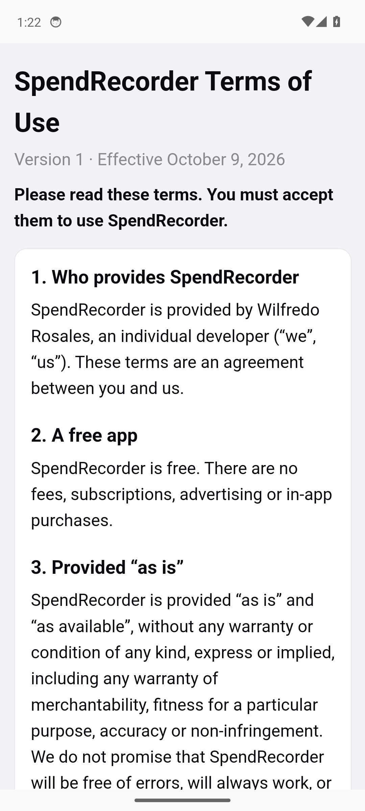

### new-expense-ready

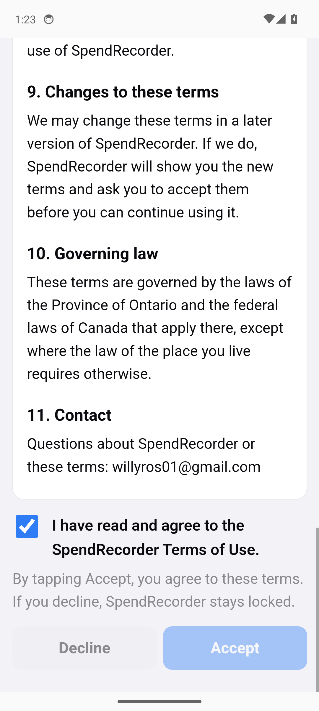

### expense-form

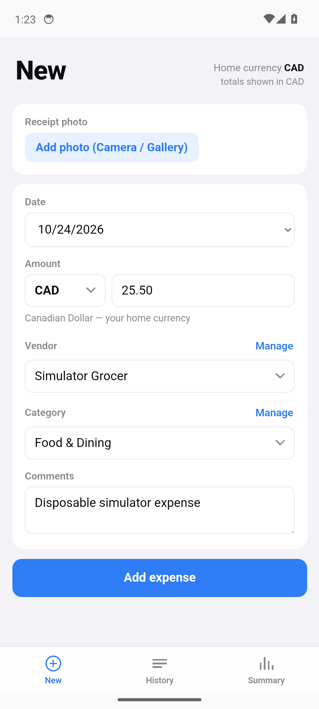

### expense-in-history

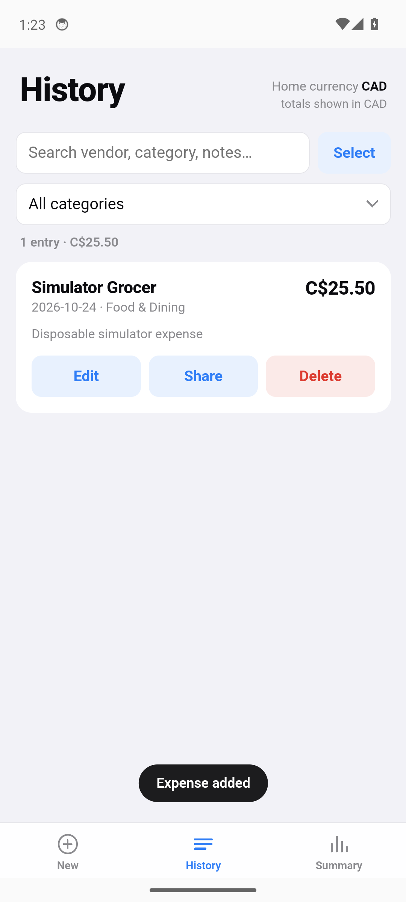

### history-after-app-restart

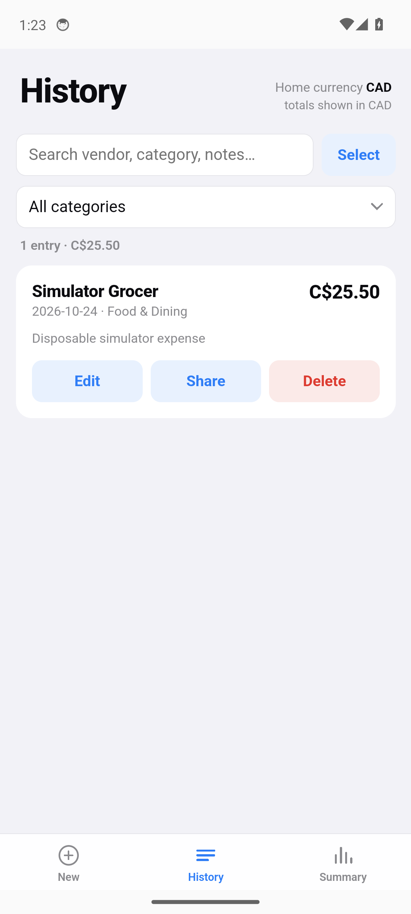

### edit-form

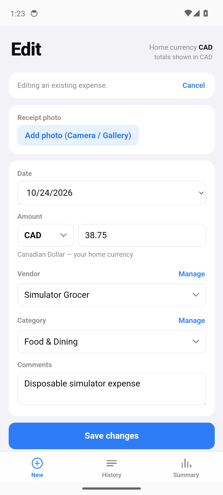

### history-after-edit

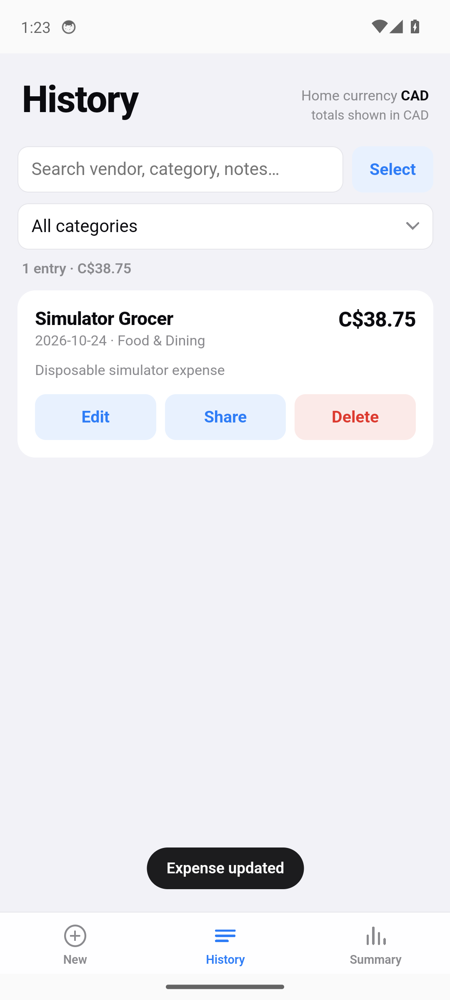

### undo-visible

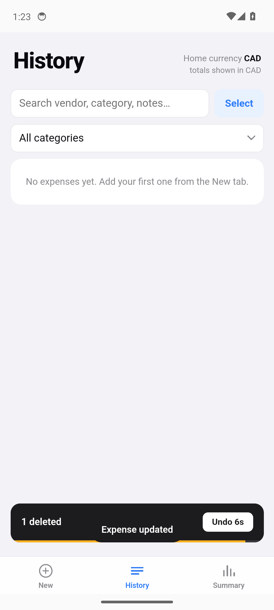

### history-restored


### receipt-after-restart

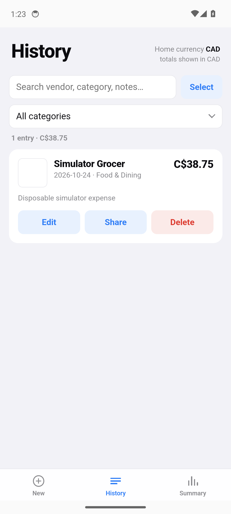

### php-manual-rate-form

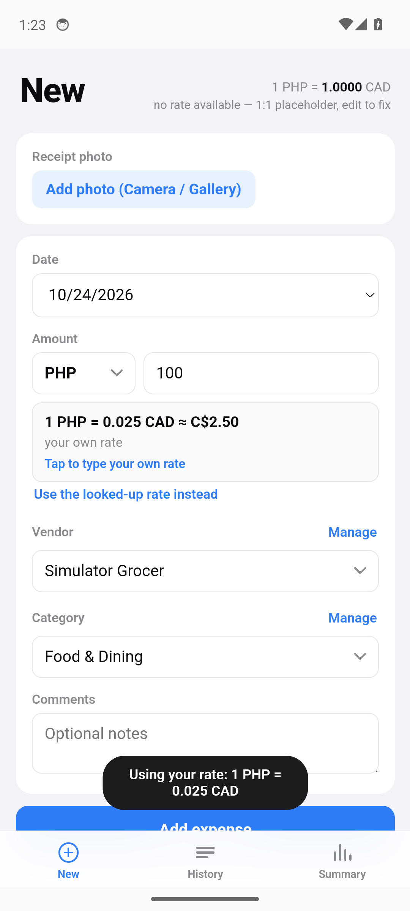

### php-expense-saved

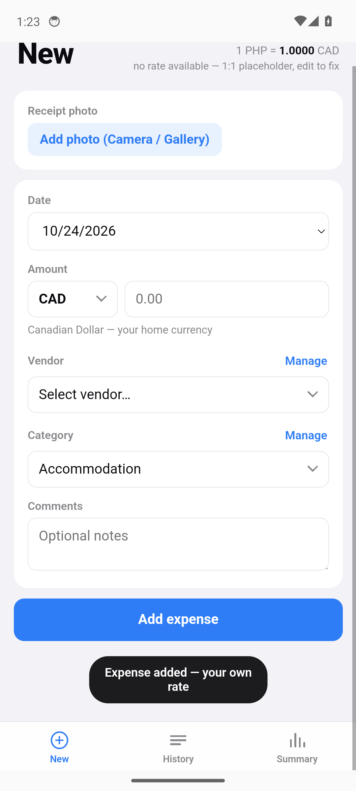

### delete-pending

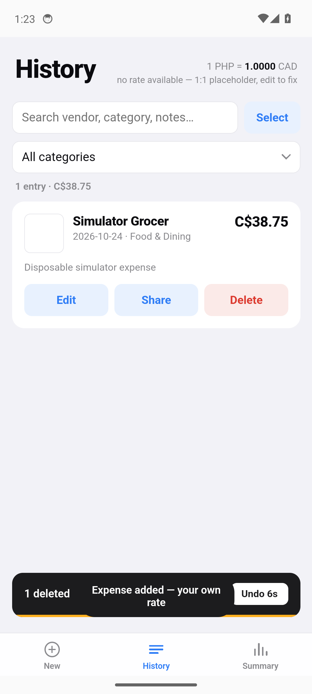

### delete-committed


### summary-total

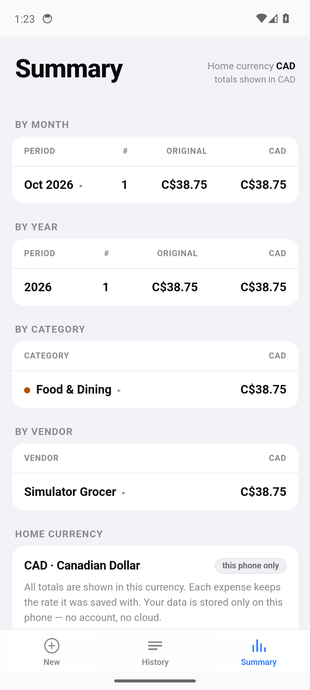

### export-options

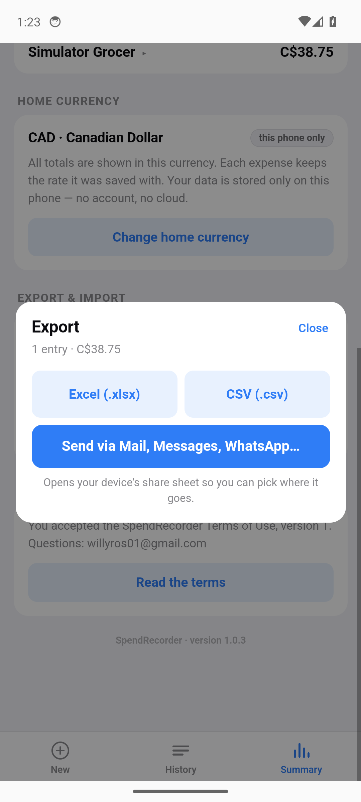

### csv-saved-to-downloads

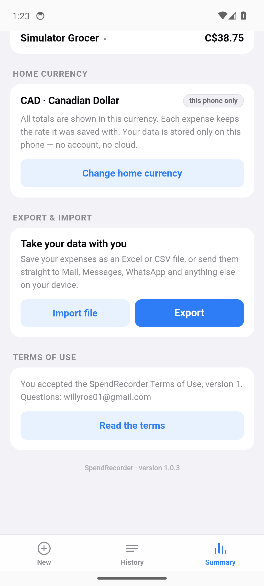

## Limits

- This report proves only the steps marked PASS. Missing steps are NOT TESTED.
- Simulator-driven DOM interactions do not establish physical hit-target or accessibility behavior.
- The receipt test uses an image fixture to verify SQLite persistence, not a physical camera.
- The iPhone simulator cannot establish that the native sharing sheet saves into a user-selected cloud folder.
- Fire HD 8 and physical iPhone acceptance remain separate.
